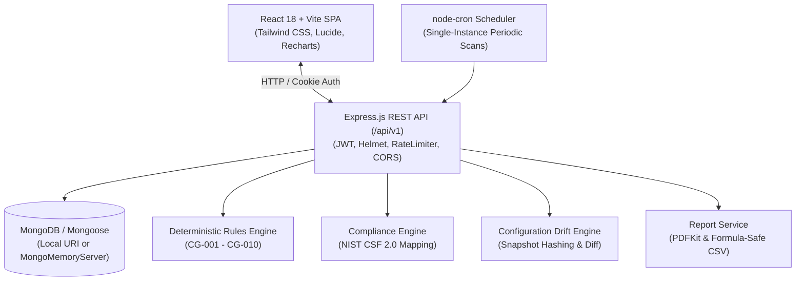

# CloudGuard — Cloud Security Posture & Compliance Monitoring Platform

[]()
[]()
[]()
[]()

> **CloudGuard** is a centralized, enterprise-grade Cloud Security Posture Management (CSPM) and compliance monitoring platform designed to evaluate cloud resource configurations, detect critical misconfigurations using a deterministic rule engine, calculate explainable security posture scores, track NIST CSF 2.0 compliance, verify remediations, detect configuration drift across snapshot history, and generate executive PDF/CSV assessment reports.

---

## 1. Problem Statement & Solution

### The Problem
Modern organizations deploy multi-cloud infrastructures spanning hundreds of object storage buckets, managed databases, IAM policies, and virtual machine instances. Inadvertent security misconfigurations—such as publicly accessible S3 storage, unrestricted database ports exposed to `0.0.0.0/0`, missing MFA on privileged administrative roles, and unencrypted volumes—are the leading root cause of enterprise cloud data breaches.

### The CloudGuard Solution
CloudGuard provides a single-pane-of-glass security dashboard that continuously monitors and evaluates cloud resource configurations against a deterministic, testable security rules engine. The platform computes real-time security posture scores, tracks compliance controls inspired by **NIST CSF 2.0**, enables risk acceptance exception tracking with mandatory expiration dates, validates remediations via live verification scans, traces configuration drift, and generates executive reports.

---

## 2. Platform Architecture



---

## 3. Technology Stack

| Layer | Technologies |
|---|---|
| **Frontend** | React 18, Vite 6, Tailwind CSS 3, React Router v6, Lucide React, Recharts, Axios |
| **Backend** | Node.js (v20+), Express.js 4, Mongoose 8, JWT, bcryptjs, Helmet, express-rate-limit, Multer |
| **Database** | MongoDB (Production URI) with automatic, zero-dependency `mongodb-memory-server` local fallback |
| **Reporting** | PDFKit (custom executive vector PDF generation), CSV serializer with formula-injection sanitization |
| **Scheduling** | node-cron (UTC periodic scan runner) |
| **Testing** | Vitest 3, Supertest 7 (35 automated unit and integration tests) |

---

## 4. Key Features

- **Deterministic Assessment Engine**: 10 purpose-built security rules evaluating configuration telemetry rather than mere asset labels.
- **Explainable Risk Scoring**:
  - **Posture Score**: Starts at 100 baseline; deducts weighted penalties per active finding (`Critical: -20`, `High: -10`, `Medium: -4`, `Low: -1`).
  - **Explainable Finding Risk Score (0-100)**: Transparent calculation based on Base Severity, Asset Criticality, Public Exposure, and Environment Tier.
- **NIST CSF 2.0 Compliance Tracking**: 10 controls spanning Governance, IAM, Data Protection, Network Security, Logging, and Recovery.
- **Verification Scan Workflow**: When an asset configuration is corrected, users trigger an automated verification scan that re-evaluates the rule and resolves the finding upon evidence proof.
- **Configuration Drift History**: Preserves normalized snapshots of each scan, diffing field-level changes to identify newly introduced regressions or confirmed improvements.
- **Executive PDF & CSV Reports**: Generates professional PDF reports with executive summaries, posture gauges, severity matrices, and compliance methodology disclaimers.
- **Role-Based Access Control (RBAC)**: Distinct permissions for `Administrator` (rule overrides, settings, accounts) and `Security Analyst` (scans, findings, verification).
- **Zero-Dependency Startup**: Automatic fallback to embedded in-memory MongoDB if no local MongoDB service is running.

---

## 5. Security Rules Catalog

| Rule ID | Rule Name | Category | Default Severity | Target Resource Types |
|---|---|---|---|---|
| **CG-001** | Public storage bucket access detected | Storage Security | `Critical` | `storage_bucket` |
| **CG-002** | Public database exposure detected | Database Security | `Critical` | `database` |
| **CG-003** | Storage encryption at rest disabled | Storage Security | `High` | `storage_bucket` |
| **CG-004** | Privileged identity missing MFA | IAM | `High` | `iam_user`, `iam_role` |
| **CG-005** | Overly permissive wildcard IAM policies | IAM | `High` | `iam_user`, `iam_role`, `iam_policy` |
| **CG-006** | Security audit logging disabled | Logging & Monitoring | `Medium` | `audit_log`, `storage_bucket`, `database` |
| **CG-007** | Insecure transport (missing TLS/HTTPS) | Data Protection | `High` | `storage_bucket`, `virtual_machine`, `database` |
| **CG-008** | Missing mandatory governance tags | Governance & Tags | `Low` | All resources |
| **CG-009** | Public administrative network ports (SSH/RDP) | Network Security | `High` | `virtual_machine`, `security_group` |
| **CG-010** | Database backup protection disabled | Backup & Recovery | `Medium` | `database` |

---

## 6. Getting Started & Installation

### Prerequisites
- **Node.js**: v20.x or higher
- **npm**: v10.x or higher
- **MongoDB** (Optional): A running MongoDB instance at `mongodb://127.0.0.1:27017`. If MongoDB is not installed or running, CloudGuard **automatically falls back to an embedded in-memory MongoDB instance** so you can run the application with zero setup!

### Step 1: Install Dependencies
From the workspace root (`d:\FSD`):
```bash
# Install backend dependencies
cd server
npm install

# Install frontend dependencies
cd ../client
npm install
```

### Step 2: Seed Demonstration Data
Populate realistic cloud accounts, secure and intentionally vulnerable assets, security rules, and baseline assessment scans:
```bash
cd server
npm run seed
```

### Step 3: Start the Application

#### Option A: Start Backend and Frontend in Separate Terminals
**Terminal 1 (Backend API):**
```bash
cd server
npm start
# Server starts at http://localhost:5000
```

**Terminal 2 (Frontend Client):**
```bash
cd client
npm run dev
# Vite dev server starts at http://localhost:5173
```

#### Option B: Workspace Scripts from Root
```bash
npm run server:dev
npm run client:dev
```

Open your browser at **[http://localhost:5173](http://localhost:5173)**.

---

## 7. Demo Login Credentials

The seed script creates two pre-configured accounts with distinct privileges:

| Role | Email Address | Password | Permissions |
|---|---|---|---|
| **SecOps Lead (Admin)** | `admin@cloudguard.io` | `CloudGuard@2026Admin!` | Full administrative access, rule governance, org settings |
| **Security Analyst** | `analyst@cloudguard.io` | `CloudGuard@2026Analyst!` | Run scans, triage findings, verify remediations, export reports |

> **Tip**: The login screen features **1-Click Quick Fill buttons** for both roles to facilitate seamless demonstration and grading.

---

## 8. Sample JSON Configuration Import Schema

Users can import custom cloud resource configurations under **Resource Inventory → Import Configuration JSON**:

```json
{
  "provider": "simulated",
  "accountName": "Demo Production Workloads",
  "region": "us-east-1",
  "resources": [
    {
      "resourceId": "prod-customer-documents",
      "type": "storage_bucket",
      "name": "customer-documents",
      "environment": "production",
      "criticality": "critical",
      "configuration": {
        "publicAccess": false,
        "encryptionEnabled": true,
        "versioningEnabled": true,
        "tlsRequired": true
      },
      "tags": {
        "owner": "platform-team",
        "environment": "production",
        "dataClassification": "confidential"
      }
    }
  ]
}
```

Pre-made test fixtures are provided in `sample-data/`:
- `sample-data/secure-resources.json`: Compliant cloud resources.
- `sample-data/vulnerable-resources.json`: Resources intentionally violating rules CG-001 through CG-010.
- `sample-data/mixed-environment.json`: Balanced enterprise environment across dev, stage, and prod.

---

## 9. Running Automated Tests

CloudGuard includes a comprehensive test suite covering all 10 security rules, scoring formulas, and REST API integration:

```bash
cd server
npm test
```

**Test Execution Results:**
```
✓ tests/scoring.test.js (5 tests)
✓ tests/rules.test.js (25 tests)
✓ tests/api.test.js (5 tests)

Test Files  3 passed (3)
     Tests  35 passed (35)
```

To build the client production bundle:
```bash
cd client
npm run build
```

---

## 10. REST API Specification Summary

All endpoints are versioned under `/api/v1` and protected by JWT authentication:

| Method | Endpoint | Description |
|---|---|---|
| `POST` | `/api/v1/auth/login` | Authenticate user and issue session token |
| `POST` | `/api/v1/auth/register` | Register new user account with least-privilege defaults |
| `GET` | `/api/v1/auth/me` | Fetch authenticated session profile |
| `GET` | `/api/v1/dashboard/summary` | Retrieve aggregated posture KPIs, charts, and rankings |
| `GET` | `/api/v1/cloud-accounts` | List monitored cloud accounts |
| `POST` | `/api/v1/cloud-accounts` | Provision new cloud account |
| `GET` | `/api/v1/resources` | Query resource inventory with search, filters, pagination |
| `POST` | `/api/v1/resources/import` | Validate and import JSON resource configurations |
| `POST` | `/api/v1/scans` | Initiate on-demand security assessment scan |
| `GET` | `/api/v1/scans/:id` | Retrieve scan execution summary |
| `GET` | `/api/v1/scans/:id/diff` | Compare configuration drift against prior snapshot |
| `GET` | `/api/v1/findings` | Filter security findings by severity, status, category |
| `PATCH` | `/api/v1/findings/:id/status` | Transition finding lifecycle status with audit logging |
| `POST` | `/api/v1/findings/:id/accept-risk` | Authorize risk exception with mandatory justification & expiry |
| `POST` | `/api/v1/findings/:id/verify` | Execute verification scan to confirm remediation by evidence |
| `GET` | `/api/v1/compliance/summary` | Compute NIST CSF 2.0 compliance percentage & coverage |
| `GET` | `/api/v1/rules` | List security rules |
| `PATCH` | `/api/v1/rules/:id` | Enable/disable rule or override severity (Admin only) |
| `POST` | `/api/v1/reports` | Generate executive PDF or CSV export |
| `GET` | `/api/v1/reports/:id/download` | Authorized stream download of report artifacts |
| `GET` | `/api/v1/notifications` | Fetch security alerts |
| `GET` | `/api/v1/audit-logs` | Retrieve append-only administrative audit trail |

---

## 11. Scope, Limitations & Future Enhancements

- **Simulated Environment Assessment**: Current implementation executes deterministic rule evaluation over structured JSON cloud configurations without requiring AWS or cloud provider billing credentials.
- **In-Process Scheduler**: Scheduled assessments are driven by `node-cron` in the backend process. In high-scale distributed deployments, this should be migrated to Redis-backed queues (BullMQ) or AWS EventBridge.
- **Future Cloud Provider Integration**: Architecture incorporates provider abstractions ready to ingest live read-only AWS STS role credentials and Azure service principals.
