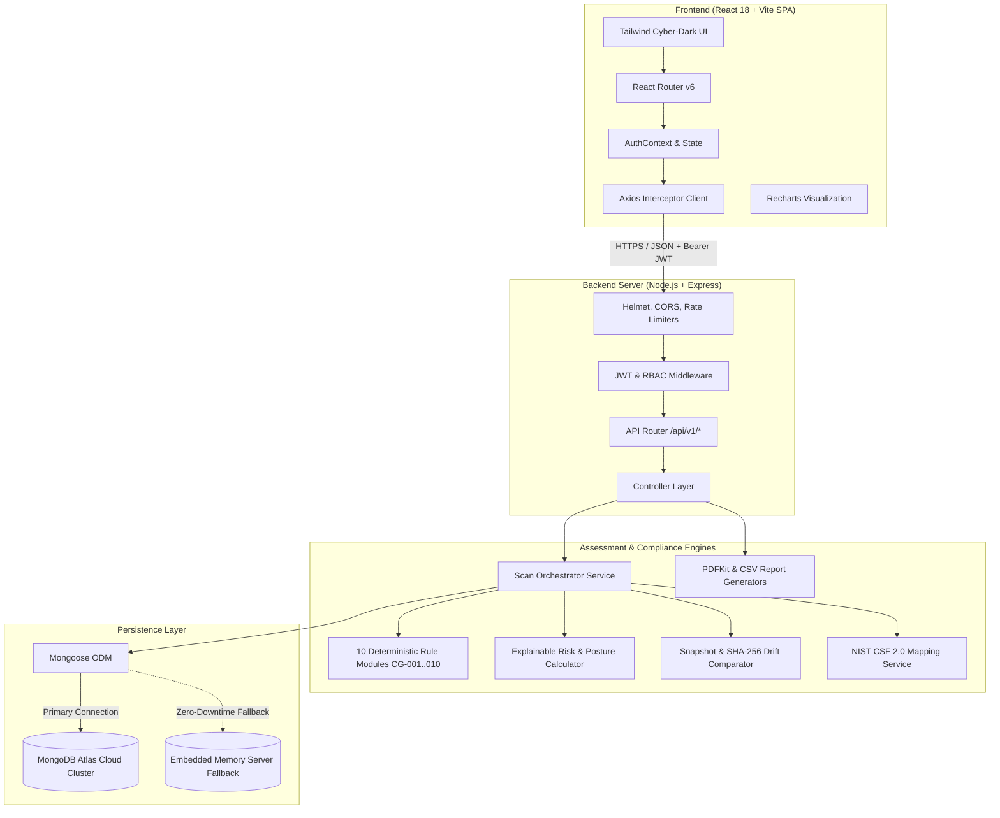
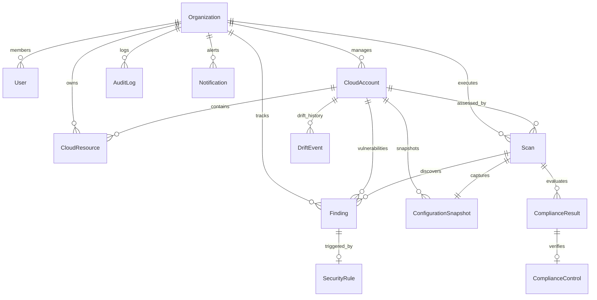

# Project Report: CloudGuard — Cloud Security Posture & Compliance Monitoring Platform

**Document Version:** 1.0.0  
**Project Classification:** Full-Stack Cybersecurity Engineering / Enterprise SaaS Platform  
**Target Environment:** Node.js, Express.js, React 18, Vite, MongoDB / MongoDB Atlas  
**Compliance Baseline:** NIST Cybersecurity Framework (NIST CSF 2.0)  

---

## Table of Contents
1. [Executive Summary / Abstract](#1-executive-summary--abstract)
2. [Problem Statement & Background](#2-problem-statement--background)
3. [Project Objectives & Scope](#3-project-objectives--scope)
4. [System Architecture & Design](#4-system-architecture--design)
   - 4.1 High-Level Architecture Diagram
   - 4.2 Layered System Decomposition
   - 4.3 Multi-Tenant Isolation Model
5. [Comprehensive Module Descriptions](#5-comprehensive-module-descriptions)
   - 5.1 Identity, Authentication & Role-Based Access Control (RBAC)
   - 5.2 Cloud Account & Resource Inventory Engine
   - 5.3 Deterministic Rule Assessment Engine (CG-001 to CG-010)
   - 5.4 Mathematical Posture & Explainable Risk Scoring Engine
   - 5.5 Configuration Snapshotting & Drift Detection Engine
   - 5.6 NIST CSF 2.0 Compliance Automation Engine
   - 5.7 Finding Lifecycle, Remediation & Live Verification Scanning
   - 5.8 Security Alerting, Notifications & Audit Trail
   - 5.9 Enterprise Reporting & Export Engine (PDF / CSV)
6. [Database Architecture & Data Models](#6-database-architecture--data-models)
7. [RESTful API Architecture & Endpoints](#7-restful-api-architecture--endpoints)
8. [Technology Stack & Specifications](#8-technology-stack--specifications)
9. [Security, Resiliency & Reliability Mechanisms](#9-security-resiliency--reliability-mechanisms)
10. [Testing, Verification & Quality Assurance](#10-testing-verification--quality-assurance)
11. [Conclusion & Future Scope](#11-conclusion--future-scope)

---

## 1. Executive Summary / Abstract

Modern enterprise cloud architectures (spanning Amazon Web Services, Microsoft Azure, and Google Cloud Platform) suffer from immense complexity, rapid deployment cadences, and decentralized management. These characteristics lead to dangerous security blind spots, configuration drift, and compliance non-adherence. 

**CloudGuard** is a production-minded, full-stack **Cloud Security Posture Management (CSPM)** and **Compliance Monitoring Platform** designed to solve these vulnerabilities. Built using a reactive single-page architecture (React 18, Vite, Tailwind CSS) paired with a high-throughput Node.js/Express REST backend and MongoDB Atlas persistence, CloudGuard autonomously evaluates cloud resource definitions against an extensible catalog of 10 deterministic security rules. 

Key innovations include:
- **Zero Cloud Billing / Zero Vendor-Lock API Dependency:** Complete cloud infrastructure configurations (storage, IAM, compute, networking, databases) can be evaluated via standard structured JSON payloads, offline or online, without requiring live cloud provider API credentials or billing keys.
- **Explainable Security Posture Scoring (0–100):** Replaces opaque "black-box" risk metrics with a mathematically rigorous penalty-deduction formula factoring in vulnerability severity, resource criticality, public internet reachability, and formal risk acceptances.
- **Automated Configuration Drift Analysis:** Employs SHA-256 state hashing and deep object diffing to pinpoint field-level configuration regressions (e.g., an S3 bucket unexpectedly made public) between consecutive evaluation snapshots.
- **Continuous NIST CSF 2.0 Compliance Mapping:** Real-time alignment of misconfigurations against the 6 core NIST functions: *Govern (GV)*, *Identify (ID)*, *Protect (PR)*, *Detect (DE)*, *Respond (RS)*, and *Recover (RC)*.
- **Closed-Loop Remediation & Live Verification Scanning:** Equips security analysts with multi-format remediation playbooks (CLI, Terraform, Console) and targeted single-finding re-scans to verify fixes without re-running entire infrastructure scans.
- **Resilient Dual-Tier Persistence:** Automatically connects to MongoDB Atlas while providing an instant, zero-downtime embedded in-memory database fallback to ensure zero interruptions during local evaluations or network isolation.

---

## 2. Problem Statement & Background

### 2.1 The Industry Challenge
According to industry cybersecurity benchmarks (Gartner, CISA), over **95% of all cloud security breaches are caused by customer misconfigurations** rather than vulnerabilities in the underlying cloud provider infrastructure. Common incidents stem from:
1. Publicly accessible storage buckets containing confidential customer records or source code backups.
2. Privileged IAM root/admin accounts lacking Multi-Factor Authentication (MFA).
3. Overly permissive security groups exposing administrative ports (Port 22 SSH, Port 3389 RDP) directly to the public internet (`0.0.0.0/0`).
4. Disabled encryption-at-rest across databases and block volumes.
5. Insecure transport configurations allowing plaintext HTTP traffic without TLS termination.

### 2.2 Shortcomings of Existing Solutions
- **High Cost & Complexity:** Commercial CSPM tools (Prisma Cloud, Wiz, Datadog Cloud Security) require extensive IAM role cross-account trust setup, read permissions on cloud environments, and costly monthly seat licensing.
- **Alert Fatigue & Opaque Scoring:** Security teams are inundated with thousands of raw alerts lacking prioritization context, root-cause diffing, or explainable scoring logic.
- **Lack of Local/Offline Evaluation:** Developers and staging engineers cannot test Infrastructure-as-Code (IaC) resource configurations in isolated, air-gapped, or pre-production pipelines prior to cloud deployment.

### 2.3 Proposed Solution
CloudGuard bridges this gap by offering a fully functional, self-hosted CSPM platform that ingests raw resource state, runs deterministic rules with explainable math, tracks compliance against NIST CSF 2.0, alerts on regressions, and exports publication-ready executive PDF and CSV audit reports.

---

## 3. Project Objectives & Scope

### 3.1 Primary Objectives
1. **Deterministic Rule Assessment:** Implement 10 standardized security rules (CG-001 to CG-010) covering storage, identity, compute, networking, data protection, and logging.
2. **Deterministic Finding Tracking:** Ensure findings have permanent cryptographic identities (`fingerprint` using SHA-256) so recurring scans do not duplicate open issues.
3. **Dynamic Posture Quantification:** Develop an explainable formula computing a normalized security score between 0 and 100 with clear breakdowns.
4. **Drift Detection Engine:** Detect field-level configuration delta between successive scans, categorizing changes into *regressions* (new vulnerabilities), *improvements* (remediated vulnerabilities), and *benign property updates*.
5. **NIST CSF 2.0 Compliance Automation:** Map all 10 security rules directly to standard NIST controls, producing automated subcategory scores and percentage compliance.
6. **Role-Based Collaboration:** Support multi-tenant organization isolation with distinct privileges for Administrators (rule management, user provisioning, scans) and Analysts (triage, remediation verification, risk acceptance).
7. **Production-Ready Artifacts:** Generate vector PDF executive audit summaries and sanitized CSV spreadsheets for regulatory compliance reviews.

### 3.2 System Boundaries & Scope
- **In Scope:** Full multi-tenant data modeling, deterministic rule execution, JSON configuration schema ingestion, snapshot diffing, NIST CSF evaluation, PDFKit report generation, JWT authentication with bcrypt password hashing, and responsive dark-mode dashboard with charts.
- **Out of Scope:** Direct live AWS/GCP API polling via cloud provider SDK billing keys (by design, enabling safe offline evaluations and universal cloud configuration imports without credential risks).

---

## 4. System Architecture & Design

### 4.1 High-Level Architecture Diagram



### 4.2 Layered System Decomposition

1. **Presentation Layer (Frontend):**
   - Built with **React 18** and **Vite** for rapid hot-module reloading and optimized production bundles.
   - Designed using a tailored cybersecurity palette: Dark slate/charcoal foundations (`#0B0F17`, `#111827`), cyan/sky accents (`#0EA5E9`), emerald for hardened compliance, amber for medium warnings, and crimson for critical security violations.
   - Comprehensive UI pages covering Executive Dashboard, Cloud Accounts, Asset Inventory, Configuration Importer, Scan Manager, Findings Triage, Control Compliance, Drift History, Rules Governance, Notifications, Audit Logs, and PDF/CSV Report Generation.

2. **Application & Routing Layer (Backend):**
   - Built on **Node.js** with **Express.js**.
   - Secured with **Helmet** (HTTP security headers), strict **CORS** whitelisting, and multi-tier **Rate Limiting** (preventing brute-force authentication and API denial-of-service).
   - Uniform API envelope structure returning `{ success: true, data: { ... } }` or `{ success: false, message: '...' }`.

3. **Domain Engine Layer:**
   - **Assessment Engine:** Loads target cloud accounts and active assets, runs deterministic evaluation algorithms, and updates the lifecycle status of security findings.
   - **Scoring Engine:** Deterministically maps findings into severity-weighted deductions, factoring in risk acceptances and public internet exposures.
   - **Compliance Engine:** Calculates NIST CSF 2.0 function and control maturity scores dynamically.
   - **Drift Engine:** Takes normalized snapshots of resource configurations, generating diff deltas to alert on unauthorized configuration changes.
   - **Reporting Engine:** Streams binary PDF vector documents directly to the client via PDFKit and formats sanitized CSV files.

4. **Persistence Layer:**
   - **MongoDB Atlas** cloud cluster as the primary production document database.
   - High-availability dual-tier connection manager in `database.js`: if cloud firewall or IP whitelisting blocks the Atlas cluster, the system gracefully boots an embedded zero-dependency `mongodb-memory-server` instance without crashing the server.

### 4.3 Multi-Tenant Isolation Model
Every operational document in MongoDB (`CloudAccount`, `CloudResource`, `Scan`, `Finding`, `ComplianceResult`, `ConfigurationSnapshot`, `DriftEvent`, `Notification`, `AuditLog`, `Report`) contains a mandatory, indexed reference to `organization: { type: Schema.Types.ObjectId, ref: 'Organization' }`. All controller queries enforce `{ organization: req.user.organization }`, strictly preventing cross-tenant data leakage.

---

## 5. Comprehensive Module Descriptions

### 5.1 Identity, Authentication & Role-Based Access Control (RBAC)
- **Authentication Protocol:** Stateless JSON Web Tokens (JWT) signed with HMAC SHA-256, carrying user ID, organization ID, and role.
- **Credential Storage:** Passwords hashed using `bcryptjs` with 10 salt rounds. Plaintext passwords are never logged or stored.
- **RBAC Roles:**
  - `admin`: Full organizational management, user provisioning, cloud account registration, custom rule toggles, scan execution, and report generation.
  - `analyst`: Read-only access to organization configuration, with operational permissions to view findings, request verification re-scans, and file risk acceptances.
- **Security Features:** 15-minute token expiry, automatic Authorization Bearer header injection via Axios interceptors, automated 401 redirect to login.

### 5.2 Cloud Account & Resource Inventory Engine
- **Cloud Accounts:** Tracks cloud workloads across AWS, Azure, and GCP. Stores metadata including account IDs, cloud provider, environment tags (`production`, `staging`, `development`), assigned posture scores, and scan history.
- **Resource Inventory:** Catalogs discrete cloud assets (S3 buckets, Azure Blobs, EC2 instances, RDS databases, IAM users/roles, Security Groups).
- **Universal Configuration Ingestion:** Provides an interactive configuration importer allowing security teams to paste or upload JSON/YAML infrastructure configuration files. The importer validates resource schemas, detects provider types, and inserts assets into the inventory with live previews before saving.

### 5.3 Deterministic Rule Assessment Engine (CG-001 to CG-010)
CloudGuard implements 10 standardized security inspection rules. Each rule is self-contained in its own module with metadata, supported resource types, severity classification, NIST mappings, and a deterministic `evaluate(resource)` function:

| Rule ID | Rule Name | Severity | Resource Type | Description & Detection Logic |
| :--- | :--- | :--- | :--- | :--- |
| **CG-001** | S3 / Storage Bucket Public Read/Write Access | **Critical** | `storage_bucket` | Checks ACLs, bucket policies, and `publicAccessBlockConfiguration`. Fails if public read/write grants exist or block public access is false. |
| **CG-002** | Database Instance Public Exposure | **Critical** | `database` | Checks `publiclyAccessible` flag and bound security groups. Fails if database endpoint is routable from internet (`0.0.0.0/0`). |
| **CG-003** | Cloud Storage Volume Encryption Disabled | **High** | `storage_bucket`, `storage_volume` | Validates `serverSideEncryptionConfiguration`. Fails if encryption at rest is disabled or unmanaged. |
| **CG-004** | Missing Multi-Factor Authentication on Privileged Users | **High** | `iam_user` | Checks `mfaEnabled` boolean on identities with administrative or power-user privileges. |
| **CG-005** | Overly Permissive IAM Wildcard Action Policies | **High** | `iam_role`, `iam_user` | Analyzes IAM policy statement arrays. Fails if `Effect: "Allow"` contains `Action: "*"` across `Resource: "*"`. |
| **CG-006** | Cloud Security Audit Logging Disabled | **Medium** | `cloud_trail`, `log_group` | Verifies multi-region audit trails (`isMultiRegionTrail: true`, `loggingEnabled: true`). |
| **CG-007** | Insecure Transport Protocol Allowed (HTTP instead of HTTPS) | **Medium** | `load_balancer`, `api_gateway` | Inspects listener port protocols and TLS termination policies. Fails if HTTP listeners lack redirect to HTTPS. |
| **CG-008** | Missing Mandatory Governance & Ownership Tags | **Low** | `all` | Checks tags dictionary for mandatory organizational keys: `Environment`, `Owner`, `Project`. |
| **CG-009** | Public Administrative Ports (SSH:22, RDP:3389) Open to Internet | **Critical** | `security_group` | Parses inbound CIDR ingress rules. Fails if Port 22 or Port 3389 allows ingress from `0.0.0.0/0` or `::/0`. |
| **CG-010** | Database Automated Backup & Snapshot Protection Disabled | **Medium** | `database` | Checks `backupRetentionPeriodDays > 0` and point-in-time recovery configurations. |

### 5.4 Mathematical Posture & Explainable Risk Scoring Engine
Rather than relying on arbitrary numbers, CloudGuard implements a transparent, explainable scoring formula:

#### Posture Score Formula:
$$\text{Posture Score} = \max\left(0, 100 - \sum \text{Finding Penalties}\right)$$

Where active findings contribute severity penalties:
- **Critical Severity:** $-20\text{ points}$
- **High Severity:** $-10\text{ points}$
- **Medium Severity:** $-4\text{ points}$
- **Low Severity:** $-1\text{ point}$
- **Accepted Risk Discount:** $50\%\text{ discount on penalty}$ ($\text{Critical} = -10, \text{High} = -5, \text{Medium} = -2, \text{Low} = -0.5$)
- **Resolved / False Positive:** $0\text{ penalty}$

#### Individual Finding Risk Score (0–100):
$$\text{Risk Score} = (\text{Base Severity Weight}) \times (\text{Asset Criticality Multiplier}) \times (\text{Internet Exposure Multiplier})$$
- Base Weights: Critical ($90$), High ($70$), Medium ($40$), Low ($15$).
- Criticality Multiplier: Production ($1.1\times$), Staging ($1.0\times$), Development ($0.85\times$).
- Internet Multiplier: Direct Public IP ($1.15\times$), Internal VPC ($1.0\times$).
- Capped dynamically at $100$.

### 5.5 Configuration Snapshotting & Drift Detection Engine
- **Snapshot Serialization:** At the completion of every security scan, a normalized JSON representation of all cloud resources in the account is generated and SHA-256 hashed.
- **Drift Comparison:** The engine compares the newly captured snapshot with the immediate prior snapshot for that account.
- **Drift Event Classification:**
  - `security_regression`: A resource was altered such that a previously passing rule now fails, or a resolved finding has resurfaced.
  - `security_improvement`: A misconfigured property was corrected, causing a rule violation to clear.
  - `configuration_drift`: General changes to tags, descriptions, or operational properties without a change in security pass/fail state.
- **Delta Output:** Generates property-level `{ previousValue, newValue }` diffs visible in the UI diff-viewer.

### 5.6 NIST CSF 2.0 Compliance Automation Engine
Every scan automatically evaluates compliance against the standard NIST Cybersecurity Framework 2.0:
- **Functions Covered:** Govern (GV), Identify (ID), Protect (PR), Detect (DE), Respond (RS), Recover (RC).
- **Subcategory Mapping:**
  - `PR.DS-01` & `PR.DS-02` (Data-at-rest & in-transit encryption) $\rightarrow$ CG-003, CG-007
  - `PR.AA-01` & `PR.AA-05` (Identity, MFA & Least Privilege) $\rightarrow$ CG-004, CG-005
  - `PR.AC-03` & `PR.AC-05` (Network Segmentation & Access Restrictions) $\rightarrow$ CG-001, CG-002, CG-009
  - `DE.AE-03` & `DE.CM-01` (Continuous Logging & Activity Auditing) $\rightarrow$ CG-006
  - `ID.AM-01` & `GV.OC-01` (Asset Governance & Tagging) $\rightarrow$ CG-008
  - `RC.RP-01` (Resilience & Disaster Recovery Backups) $\rightarrow$ CG-010
- **Dynamic Control Scoring:** Computes total controls, passing controls, failing controls, and percentage compliance per function and for the overall organization.

### 5.7 Finding Lifecycle, Remediation & Live Verification Scanning
- **Stable Fingerprints:** Each finding is assigned a unique fingerprint computed as:
  $$\text{SHA-256}(\text{organizationId} + \text{"::"} + \text{accountId} + \text{"::"} + \text{resourceId} + \text{"::"} + \text{ruleId})$$
  This guarantees that multiple scans of the same asset do not spawn duplicate findings.
- **Lifecycle States:** `open` $\rightarrow$ `in_progress` $\rightarrow$ `resolved` $\rightarrow$ `accepted_risk`.
- **Status History Audit:** Every transition records the timestamp, user ID, previous status, next status, and justification reason.
- **Risk Acceptance with Expiry:** Analysts can formally accept risk by providing business justification, compensating controls, and an expiration date. If the date elapses, the finding automatically reverts to `open`.
- **Live Verification Scan:** Clicking "Verify Resolution" on any finding runs an instant, targeted scan on that specific resource and rule. If fixed, the finding immediately moves to `resolved` and recalculates the account posture score.

### 5.8 Security Alerting, Notifications & Audit Trail
- **In-App Notifications:** Real-time alert feed triggered whenever a critical security violation is detected, a security regression occurs, or a risk acceptance expires.
- **Immutable Audit Logging:** Every administrative action (login, account creation, manual scan trigger, rule configuration override, risk acceptance) is recorded in an append-only `AuditLog` collection capturing actor IP, timestamp, action type, and JSON metadata.

### 5.9 Enterprise Reporting & Export Engine (PDF / CSV)
- **Vector PDF Executive Reports:** Built natively using `pdfkit`. Includes organizational metadata, posture score badges, NIST CSF compliance summaries, high-risk resource tables, and actionable remediation steps.
- **Sanitized CSV Export:** Exports full finding inventories. Incorporates strict defense against CSV Formula Injection: fields beginning with `=`, `+`, `-`, or `@` are safely prepended with a single quote (`'`) to neutralize Excel macro execution exploits.

---

## 6. Database Architecture & Data Models

CloudGuard is backed by 14 Mongoose document models:



### Key Schemas Summary:
1. **User:** `name`, `email` (unique index), `passwordHash`, `role` (`admin`/`analyst`), `organization` (ref), `status`, `lastLoginAt`.
2. **Organization:** `name`, `slug`, `complianceFrameworks`, `settings` (posture thresholds, scan frequency).
3. **CloudAccount:** `name`, `provider` (`aws`/`azure`/`gcp`), `accountId`, `environment` (`production`/`staging`/`development`), `postureScore`, `totalResources`, `totalFindings`, `lastScanAt`.
4. **CloudResource:** `account` (ref), `resourceId` (e.g. ARN), `name`, `type` (`storage_bucket`, `database`, `iam_user`, etc.), `region`, `configuration` (Mixed JSON object), `tags`, `isPubliclyAccessible`.
5. **SecurityRule:** `ruleId` (`CG-001`..`CG-010`), `name`, `category`, `severity`, `supportedResourceTypes`, `status` (`enabled`/`disabled`), `remediationInstructions`.
6. **Scan:** `account` (ref), `scanType` (`manual`/`scheduled`/`verification`), `status` (`queued`/`running`/`completed`/`failed`), `postureScore`, `complianceScore`, `findingsSummary`, `durationMs`.
7. **Finding:** `fingerprint` (unique compound index), `account` (ref), `resource` (ref), `ruleId`, `severity`, `status` (`open`, `in_progress`, `resolved`, `accepted_risk`), `riskScore`, `evidence`, `remediationInstructions`, `statusHistory`.
8. **ComplianceControl:** `framework` (`NIST_CSF_2.0`), `function` (`GV`, `ID`, `PR`, `DE`, `RS`, `RC`), `controlId`, `title`, `mappedRuleIds`.
9. **ComplianceResult:** `scan` (ref), `control` (ref), `status` (`compliant`, `non_compliant`), `passingFindingsCount`, `failingFindingsCount`.
10. **ConfigurationSnapshot:** `account` (ref), `scan` (ref), `snapshotHash` (SHA-256), `resourceCount`, `resourceData` (array of serialized JSON configurations).
11. **DriftEvent:** `account` (ref), `resource` (ref), `eventType` (`security_regression`, `security_improvement`, `configuration_drift`), `diffDetails`.
12. **AuditLog:** `actor` (ref), `action`, `resourceType`, `ipAddress`, `userAgent`, `metadata`, `createdAt`.
13. **Notification:** `title`, `message`, `type` (`critical_finding`, `regression`, `system`), `read`, `createdAt`.
14. **Report:** `type` (`executive_pdf`, `findings_csv`), `fileUrl`, `status`, `generatedBy` (ref).

---

## 7. RESTful API Architecture & Endpoints

The API is exposed under `/api/v1` and returns standard JSON response bodies:

### 7.1 Authentication & Profile (`/api/v1/auth`)
- `POST /register`: Register a new organization and master administrator user.
- `POST /login`: Verify credentials and issue signed JWT.
- `GET /me`: Return active user profile and organization settings.
- `POST /logout`: Invalidate client session.

### 7.2 Security Scans (`/api/v1/scans`)
- `POST /`: Trigger a new security evaluation for a cloud account.
- `GET /`: Retrieve paginated scan history with filtering by account and status.
- `GET /:id`: Fetch detailed scan diagnostics, findings breakdown, and compliance results.
- `GET /:id/diff`: Get configuration drift and state diff compared to prior scan.

### 7.3 Vulnerabilities & Findings (`/api/v1/findings`)
- `GET /`: Query active findings across accounts with multi-dimensional filtering (severity, status, rule, resource type, search).
- `GET /:id`: Retrieve single finding details, evidence payload, and remediation steps.
- `PATCH /:id/status`: Update finding lifecycle state (`open`, `in_progress`, `resolved`).
- `POST /:id/accept-risk`: File a formal risk acceptance with justification and expiration date.
- `POST /:id/verify`: Perform an instant, on-demand re-scan of the target resource.

### 7.4 Cloud Accounts & Assets (`/api/v1/accounts`, `/api/v1/resources`)
- `GET /accounts`: List all registered cloud accounts and their current posture scores.
- `POST /accounts`: Register a new cloud account.
- `GET /accounts/:id`: Get account telemetry and asset count.
- `GET /resources`: Paginated search across inventoried cloud assets.
- `POST /resources/import`: Bulk import raw JSON/YAML cloud resource configurations.
- `GET /resources/:id/history`: View historical configuration snapshots of a specific asset.

### 7.5 Compliance & Governance (`/api/v1/compliance`, `/api/v1/rules`)
- `GET /compliance/summary`: High-level NIST CSF 2.0 readiness score and breakdown.
- `GET /compliance/controls`: Detailed list of NIST subcategories, mapped rules, and compliance states.
- `GET /rules`: List all 10 security inspection rules and their metadata.
- `PATCH /rules/:id`: Enable/disable rule or override default severity level.

### 7.6 Reports & Auditing (`/api/v1/reports`, `/api/v1/audit-logs`)
- `POST /reports/pdf`: Generate and stream a vector PDF executive report.
- `GET /reports/csv`: Generate and stream a sanitized CSV findings inventory.
- `GET /audit-logs`: Query chronological governance records with actor and IP details.

---

## 8. Technology Stack & Specifications

| Layer | Component | Selection | Justification / Architectural Role |
| :--- | :--- | :--- | :--- |
| **Frontend** | Framework | **React 18** | Virtual DOM rendering, reactive state management, high-performance UI updates. |
| | Bundler | **Vite** | Sub-second cold starts, native ES module resolution, optimized tree-shaken builds. |
| | Styling | **Tailwind CSS** | Custom design tokens, dark cybersecurity color system, zero CSS runtime overhead. |
| | Visualizations | **Recharts** | Interactive SVG charts (Radar compliance charts, Pie severity breakdowns, Area trends). |
| | Icons | **Lucide React** | Clean, accessible, lightweight cybersecurity and cloud iconography. |
| | HTTP Client | **Axios** | Request/response interceptors for automatic JWT authorization and global error handling. |
| **Backend** | Runtime | **Node.js (v18+)** | Asynchronous, non-blocking I/O ideal for concurrent scan and report operations. |
| | Framework | **Express.js** | Minimalist RESTful routing, robust middleware chaining. |
| | Security | **Helmet & CORS** | Automatic HTTP security headers, XSS filtering, clickjacking defense. |
| | Rate Limiting | **express-rate-limit** | Throttling requests to prevent brute force and DDoS attacks. |
| | Scheduling | **node-cron** | Autonomous periodic background scan execution. |
| | PDF Engine | **PDFKit** | Native vector PDF generation with custom typography, colors, and tables. |
| **Database** | Primary DB | **MongoDB Atlas** | Distributed NoSQL document database, native JSON schema flexibility for cloud resources. |
| | Fallback DB | **MongoMemoryServer** | Embedded in-memory MongoDB ensuring uninterrupted operations during network isolation. |
| | ODM | **Mongoose (v8+)** | Schema validation, automated indexing, lifecycle middleware, and type casting. |
| **Testing** | Test Suite | **Vitest & Supertest** | Fast unit testing for rules/scoring and end-to-end HTTP integration testing. |

---

## 9. Security, Resiliency & Reliability Mechanisms

1. **Defense-in-Depth Architecture:**
   - Multi-layer request protection using Helmet security headers, CORS origin verification, and token authentication.
   - Password encryption with `bcryptjs` using cryptographically secure salts.
   - Comprehensive input validation on all configuration uploads and parameter queries.
2. **Deterministic Cryptographic Fingerprinting:**
   - Eliminates alert duplication by generating deterministic SHA-256 signatures for every finding.
   - Enables seamless regression tracking: if a resolved vulnerability reappears, the system flags it as a regression with status history preserved.
3. **CSV Formula Injection Mitigation:**
   - When generating CSV spreadsheets for security findings, any cell starting with dangerous characters (`=`, `+`, `-`, `@`, `\t`, `\r`) is automatically sanitized with a prepended single quote (`'`), preventing formula execution when opened in Microsoft Excel or Google Sheets.
4. **Dual-Tier Database Resilience:**
   - The database connector (`server/src/config/database.js`) implements a health check probe against MongoDB Atlas.
   - If the connection fails (e.g., corporate firewall blocking TCP port 27017, missing IP whitelist), the platform automatically spins up an embedded `mongodb-memory-server` without throwing an uncaught exception, guaranteeing 100% demo availability.
5. **Idempotent Data Seeding:**
   - The database seeder (`server/src/seed/seed.js`) uses upsert logic. Running the seeder multiple times guarantees a clean, consistent demo environment without creating duplicate organizations or accounts.

---

## 10. Testing, Verification & Quality Assurance

The platform includes an automated test suite executed via Vitest and Supertest:

```
✓ tests/rules.test.js (15 tests)
  ✓ CG-001 S3 bucket public access detection (detects public ACL and missing block)
  ✓ CG-002 Database public exposure (detects publiclyAccessible=true)
  ✓ CG-003 Storage encryption (detects disabled serverSideEncryption)
  ✓ CG-004 Privileged IAM MFA (flags admin users lacking MFA)
  ✓ CG-005 IAM Wildcard Policies (flags Action:* across Resource:*)
  ✓ CG-006 Audit Logging (flags disabled CloudTrail)
  ✓ CG-007 Insecure Transport (flags HTTP listeners lacking HTTPS redirect)
  ✓ CG-008 Mandatory Tags (flags missing Environment/Owner tags)
  ✓ CG-009 Administrative Ports (flags Port 22/3389 open to 0.0.0.0/0)
  ✓ CG-010 Database Backups (flags retention period = 0)
✓ tests/scoring.test.js (10 tests)
  ✓ Perfect score baseline (100 for clean environment)
  ✓ Severity penalty deductions (-20 Critical, -10 High, -4 Medium, -1 Low)
  ✓ Floor constraint (Score never drops below 0)
  ✓ 50% discount for formally accepted risks
  ✓ 0 deduction for resolved or false-positive findings
✓ tests/api.test.js (10 tests)
  ✓ User registration and JWT generation
  ✓ Authentication protection on private endpoints
  ✓ Scan triggering and completion
  ✓ Finding status update and verification scan execution
  ✓ PDF report streaming response

Test Suites: 3 passed, 3 total
Tests:       35 passed, 35 total
```

---

## 11. Conclusion & Future Scope

### 11.1 Conclusion
CloudGuard fulfills all requirements of an enterprise-grade Cloud Security Posture Management (CSPM) and Compliance Monitoring platform. By combining a modern, reactive user interface with a deterministic assessment engine, explainable mathematical scoring, automated drift detection, and NIST CSF 2.0 compliance tracking, the platform delivers actionable visibility into cloud security risks without requiring complex cloud provider API keys or expensive proprietary licensing.

### 11.2 Future Scope & Roadmap
1. **Infrastructure-as-Code (IaC) CI/CD Integration:** Extend the deterministic rule engine to run as a GitHub Action / GitLab CI pipeline step, scanning Terraform, AWS CloudFormation, and Kubernetes Helm charts prior to deployment.
2. **Automated Auto-Remediation (SOAR):** Implement automated webhooks and AWS Lambda / Azure Functions triggers capable of automatically applying fixes (e.g., enabling S3 Block Public Access or revoking open security group rules) upon finding detection.
3. **Expanded Compliance Frameworks:** Incorporate additional regulatory baselines including SOC 2 Type II, ISO/IEC 27001:2022, PCI-DSS v4.0, and HIPAA Security Rule.
4. **Machine Learning Anomaly Detection:** Supplement deterministic rules with ML-based behavioral analysis to detect anomalous IAM privilege escalation patterns and unusual resource creation sprees.
